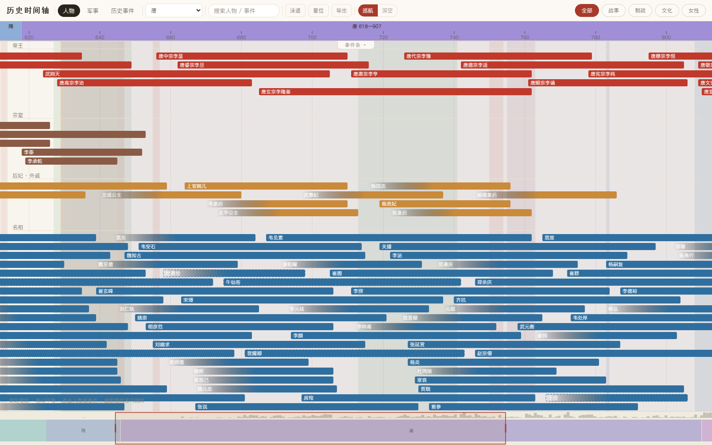

# 历史时间轴

[](https://github.com/0xenzyme/history-timeline/actions/workflows/ci.yml)

四千年中国历史人物与事件，放在同一条可缩放、可检索的时间轴上。

在线地址：<https://history.0xenzyme.dev>  
代码仓库：<https://github.com/0xenzyme/history-timeline>  
英文说明：[README.en.md](README.en.md)



## 功能

- **三条内容线**：人物、军事、历史事件共用一套画布与实体库。
- **朝代专题**：按专题查看人物，并通过章节与泳道组织内容。
- **搜索与深链**：检索人物和事件；专题、事件等状态可通过 URL 分享。
- **交互浏览**：滚轮缩放、拖动平移、详情卡片、事件条与快捷筛选。
- **导出**：将当前时间轴导出为 PNG 或 SVG。
- **两套皮肤**：巡航与深空。

事件线的时间范围为公元前 2070 年至 1949 年。历史人物与事件仍在持续补充和校订。

## 项目结构

```text
content/       人物、事件与 Collection 源文件
pipeline/      校验、编译与专题配置
public/data/   编译生成的运行时 JSON（随源文件提交）
src/           前端应用：加载、布局、画布渲染、交互与导出
tests/         node:test 测试
docs/          设计、规则与部署文档
dist/          构建产物（不提交）
```


## 本地运行

要求 Node.js 22 或更高版本。

```bash
npm ci
npm run dev
```

开发服务器默认使用 `http://localhost:5180`。

生产构建与本地预览：

```bash
npm run build
npm run preview
```

`npm run build` 会依次执行应用与流水线的 TypeScript 检查、人物校验、事件校验、Collection 校验、内容校验和 Vite 构建，输出到 `dist/`。

质量门禁：

```bash
npm test            # node:test 测试（routing / contract / layout / 流水线冒烟）
npm run format:check  # Prettier 格式校验
npm run hooks:install  # 可选：把 .githooks 设为提交前校验
```

部署由 `.github/workflows/pages.yml` 自动完成，步骤见 [部署说明](docs/部署.md)。`dist/` 也可直接上传到任意静态托管。

## 内容维护

人物源文件位于 `content/<topic>/<id>.md`，事件源文件位于 `content/events/<id>.md`，Collection 源文件位于 `content/collections/<id>.md`。运行时数据由流水线生成，并随源文件一起提交；不要手改 `public/data/`。审查时运行 `npm run content` 后查看 `git diff --stat public/data`，不逐行审 JSON。

常用命令：

```bash
npm run people:new -- <topic> <id>  # 新建人物并更新索引
npm run people:format              # 格式化人物文件与索引
npm run people:check               # 校验人物内容
npm run events:new -- <id>          # 新建事件并更新索引
npm run events:format              # 格式化事件文件与索引
npm run events:check               # 校验事件内容
npm run collections:new -- <id>     # 新建 draft Collection
npm run collections:format         # 格式化 Collection 与索引
npm run collections:check          # 校验 Collection 结构与引用
npm run content                    # 编译到 public/data/
npm run content:check              # 校验编译结果，不重写文件
```

内容规则以以下文档为准：

- [内容编写手册](pipeline/PLAYBOOK.md)：人物收录、年份精度、出处、关系与政权归属。
- [事件线规则](docs/事件线规则.md)：事件实体、时间、出处与引用规则。
- [兰台数据规格](docs/兰台数据规格.md)：人物作品与经历、事件 `partOf`、Collection 和详情产物。
- [内容目录说明](content/README.md)：人物文件和索引的组织方式。

规则冲突时按 [仓库规则](AGENTS.md) 的 Rule Precedence 执行；事件规则优先于人物手册中的事件入口说明。根目录 `AGENTS.md` 与 `.agents/skills/` 面向自动化内容生产工具，普通贡献者可以忽略，只需阅读本文件、[贡献指南](CONTRIBUTING.md) 与内容规则。

## 自动化内容生产

需要批量新增或修订历史内容时，使用[内容生产与自动准入](docs/内容工作流.md)工作流。它把研究与起草、独立审核、自动准入分到不同会话，避免同一会话既起草又批准。

- **执行会话**读取 `.agents/skills/event-production/SKILL.md`：研究并准备候选批次，运行只读预检，然后停在待审状态。
- **审核会话**读取 `.agents/skills/event-review/SKILL.md`：核对史料与完整候选，记录结论后运行准入工具，自动应用通过项、保留未通过项。

两个入口当前只覆盖事件。人物与 Collection 仍按上文的手动命令维护。候选材料保存在本地 `workspace/content/`，该目录不随站点公开，也不进入 Git。

## 史料与准确性

条目优先使用典籍和现代研究作为出处。数据库可用于发现线索，但不能单独支撑未经核实的年份。生卒年保留 `exact`、`approx`、`disputed`、`unknown` 等精度状态；史料存在分歧时，应在对应说明中保留异说。

本项目是开放协作的历史可视化，不替代专业历史研究或原始史料。发现错漏时，欢迎通过 Issue 提供条目、问题和可核查出处。

## 参与贡献

请先阅读 [贡献指南](CONTRIBUTING.md)。提交前应运行：

```bash
npm test
npm run format:check
npm run build
```

安全问题请按照 [安全政策](SECURITY.md) 私下报告。

## 许可证

- 代码：[MIT](LICENSE)。
- 原创历史文案、结构化历史内容与说明文档：[CC BY-SA 4.0](LICENSE-CONTENT.md)。
- 古籍原文、第三方材料与依赖仍遵循各自原有条款。
